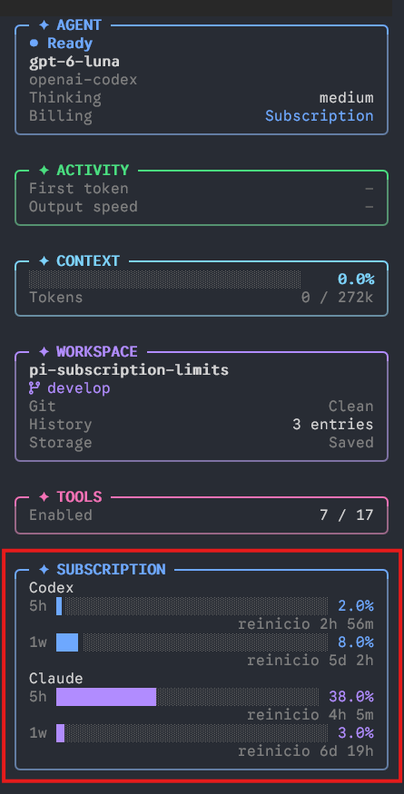
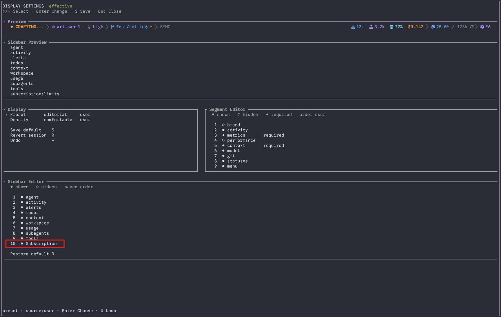

# Pi Subscription Limits

A Pi extension that adds Codex and Claude subscription windows to the Pi Atelier sidebar. It reads the OAuth sessions already configured in Pi and displays used percentage and a local reset countdown for the 5-hour and weekly windows.

## Install

Install the published package:

```bash
pi install npm:pi-subscription-limits
```

For local development, install it from its directory:

```bash
pi install ./pi-subscription-limits
```

Restart Pi, open `/atelier`, and enable the **Subscription** panel in **Settings → Display**. Contributed panels start hidden in Pi Atelier.

## Screenshots

The Subscription panel displays Codex and Claude usage windows and their local reset countdowns:



Enable the panel from the sidebar editor in **Settings → Display**:



## Data sources

The extension requests usage data when the TUI session starts. Codex refreshes every minute; Claude refreshes every 30 minutes to reduce usage-endpoint throttling. Countdown displays update every minute. HTTP 429 responses defer subsequent requests until at least the normal refresh interval, five minutes, and any server-provided `Retry-After` have elapsed. Last-known values remain visible and are marked as previous data when a refresh fails.

It resolves OAuth auth for Pi's `openai-codex` and `anthropic` providers through Pi's model registry. For Codex, it also reads stored account metadata through Pi's `readStoredCredential` API; it never writes credentials. Codex reporting requires a session for `openai-codex`. The separate `openai` provider's ChatGPT OAuth flow targets `api.openai.com` and is not substituted for Codex backend authentication. A separate `/login openai-codex` is an optional alternative for this endpoint, not a fix for an invalid `openai` login; you can keep your current model selected.

The `openai` ChatGPT subscription flow can authenticate successfully without exposing quota windows. A read-only check against `/v1/models` returned HTTP 200 without quota headers. That does not establish what every inference response contains. The same missing-window integration is tracked in [OpenAI Codex issue 54219](https://github.com/openai/codex/issues/54219). OpenAI's [errors and recovery documentation](https://developers.openai.com/siwc/token-sharing-open-source/errors-and-recovery) directs users to ChatGPT settings for usage-limit information and warns against inferring a plan reset time from an app usage-limit error.

- Codex: `https://chatgpt.com/backend-api/wham/usage`
- Claude: `https://api.anthropic.com/api/oauth/usage`

These usage interfaces are not documented public APIs and may change. The extension sends credentials only to the listed provider hosts and rejects redirects. API-key credentials are not used for subscription reporting. The panel reports missing sessions, HTTP statuses, and schema mismatches separately. It also reads Codex and Claude quota headers from normal model responses via Pi's `after_provider_response` event, when those headers are present. It does not generate extra model requests to probe usage.

Only percentages and reset timestamps are retained in memory. Tokens and account identifiers are not shown, persisted, or included in error messages. Requests have a 10-second timeout.

## Development

For a one-response diagnostic, reload the extension with `/reload`, run `/subscription-debug`, then send a normal message. The notification shows the selected provider, HTTP status, and names of quota-related response headers. It does not show header values, credentials, or message content, and it makes no additional request. The diagnostic disables itself after one response or session shutdown.

```bash
npm install
npm run typecheck
node --test test/usage.test.cjs
```

## Limitations

- Codex windows are identified by duration when supplied, with primary/secondary position used only when duration is absent. A weekly-only primary window is not also displayed as a 5-hour window. Missing windows are reported as unavailable unless a previous value is retained.
- The `openai` provider is not covered by the Codex usage endpoint integration. Passive usage data appears only if normal responses include recognized quota headers.
- The panel is separate from Atelier's built-in **AGENT** panel, using Atelier's public sidebar contribution API. It can be enabled, hidden, or repositioned in **Settings → Display**.
